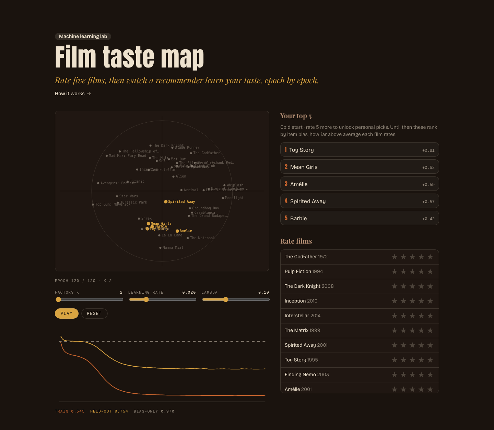
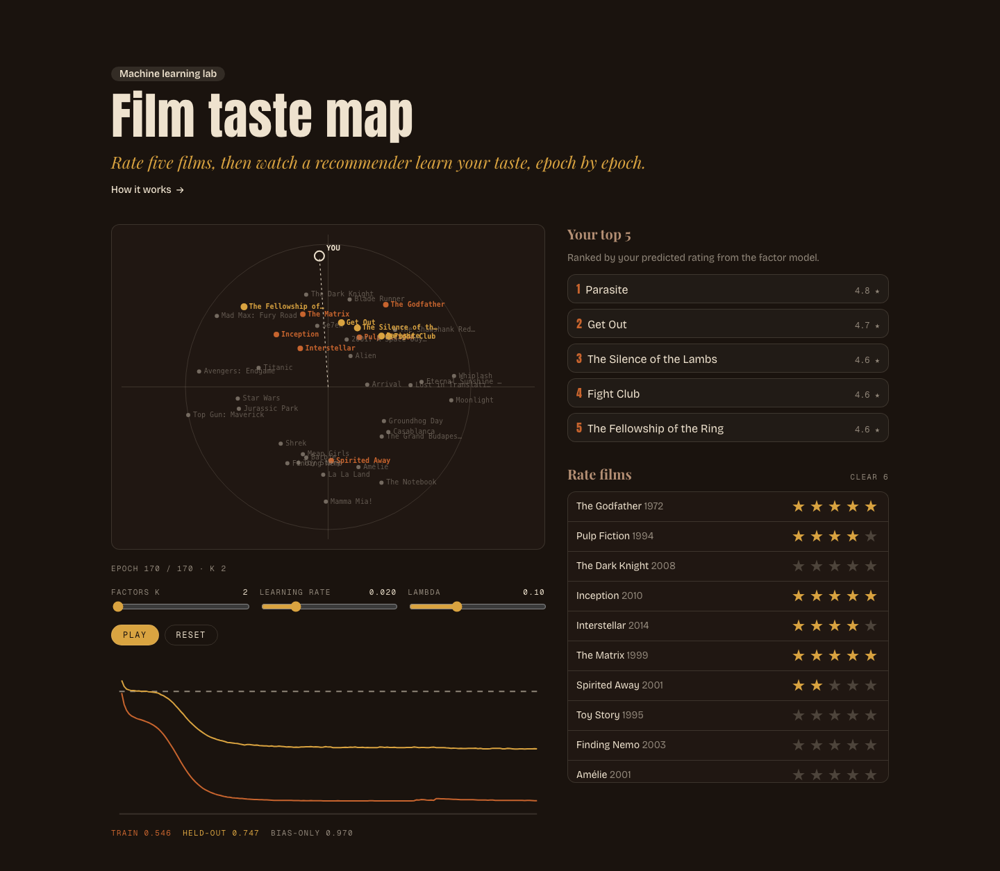

# Film Taste Map

Rate a few films and watch a from-scratch matrix factorization recommender train live in your browser, mapping film taste vectors and picking your top five.





**Live demo:** [worksofabhiram.live/machine-learning-lab/film-taste-map](https://worksofabhiram.live/machine-learning-lab/film-taste-map)

## What it is

A small collaborative filtering recommender written by hand in TypeScript, with no ML libraries. It ships with 60 synthetic users who rated 40 well known films. You rate at least five films, join as user 61, and the model trains in your browser one epoch per animation frame. You can watch the film vectors settle on a 2D map, see your own taste direction, follow train and held-out RMSE against a bias only baseline, and change k, learning rate and λ while it runs.

## How it works

### The problem

A grid of people by films where most cells are empty. The job is to fill in the blanks well enough that the highest guesses for you are films you would actually enjoy. No genres, no plot summaries, only who rated what. This is collaborative filtering: people who agreed before will probably agree again.

### The data is synthetic

There is no real shared ratings log here, so the 60 seed users are invented. Each of the 40 films gets a hand written position on three hidden axes: spectacle, darkness and how cerebral it is. Each user gets a random taste on the same three axes, a leniency, and each film a random acclaim.

```
rating = round(3.3 + leniency + acclaim + 0.8 · (taste · film) + noise)
noise ~ N(0, 0.55²), clamped to 1..5
```

Each user sees each film with a film specific probability between 25% and 65%. A seeded generator makes it deterministic: 1,047 ratings, 43.6% of the grid filled, 10 to 25 ratings per user, at least 12 per film, training mean 3.39. The model never sees the hidden axes. Noise plus rounding sets a floor: even the true noiseless score only reaches 0.613 RMSE on the held-out set.

### The model

Every user u and every film i gets a bias and a vector of k numbers. A prediction is the global mean, plus both biases, plus how well the two vectors line up.

```
r̂_ui = μ + b_u + b_i + p_u · q_i
```

Training minimises squared error on known ratings, with an L2 penalty that keeps every parameter small.

```
L = Σ_(u,i) known (r_ui − r̂_ui)² + λ (b_u² + b_i² + ‖p_u‖² + ‖q_i‖²)
```

You join as user 61. Your five or more stars become a new row, and the same training loop learns your vector alongside everyone else's.

### Training loop

Plain stochastic gradient descent, written by hand. Each epoch shuffles the known ratings with a seeded generator and, for each one, nudges the four parameters it touches.

```
e   = r_ui − r̂_ui
b_u ← b_u + η (e − λ b_u)
b_i ← b_i + η (e − λ b_i)
p_u ← p_u + η (e q_i − λ p_u)
q_i ← q_i + η (e p_u − λ q_i)
```

Vectors start as small Gaussian noise, biases at zero, μ fixed at the training mean. The page runs one epoch per animation frame so the map moves while the tab stays responsive, and jumps straight to the end when reduced motion is on. Any non finite parameter stops training and flags divergence.

The map is the film vectors projected onto their two main directions, found by power iteration on the uncentred k by k second moment matrix. Axis signs are matched to the previous frame so the map does not flip. Your point is your own vector projected the same way and drawn at a fixed radius: its direction is what matters, films that lie along it score highest.

### Hyperparameters

Defaults are **k 2**, **learning rate η 0.02**, **λ 0.10**, 120 epochs. A larger k can memorise more, a larger λ pulls everything toward the bias only model, and a larger η converges faster until it overshoots.

### Evaluation

A seeded 20% of the seed ratings (212) is held out and never trained on, leaving 835. All numbers below come from running the same TypeScript in Node, epoch 120 unless noted.

| Model | Train RMSE | Held-out RMSE |
| --- | --- | --- |
| Global mean | 1.059 | 1.076 |
| Bias only (user + film) | 0.876 | 0.970 |
| Matrix factorization, k 2 | 0.546 | 0.753 |
| Noiseless truth (floor) | · | 0.613 |

Factorization cuts held-out error by 22% against the bias only model and 30% against the global mean. Bias only uses damped averages, a film bias first and then a user bias on the residual.

| Setting, η 0.02 | Train | Held-out |
| --- | --- | --- |
| k 2, λ 0.10 | 0.546 | 0.753 |
| k 3, λ 0.10 | 0.484 | 0.787 |
| k 4, λ 0.10 | 0.440 | 0.790 |
| k 8, λ 0.10 | 0.340 | 0.797 |
| k 8, λ 0 | 0.167 | 0.993 |

The data has three true axes, yet k 2 wins. With about 14 training ratings per user the third axis costs more in variance than it buys. Turning λ off at k 8 shows overfitting plainly: train error falls to 0.167 while held-out climbs back to 0.993, after bottoming out at 0.851 on epoch 31.

### Failure modes and limits

- Cold start. With under five ratings your vector is mostly noise, so the page ranks by film bias and says so.
- Missing at random by construction. Real people rate what they chose to watch, which skews ratings upward and hides dislikes.
- One split, one seed. Differences of a few thousandths between settings are within noise for 212 held-out ratings.
- The visitor is one row among 61 and trains only while the page is open; nothing leaves your browser except to localStorage.
- The 2D map drops every direction past the first two, so neighbours on the map can still disagree.
- A high learning rate with low λ can diverge; reset with smaller values.

### With real shared data

- Train on a public log such as MovieLens and compare against these synthetic numbers.
- Split by time, not at random, so the test asks about the future.
- Tune k, η and λ on a validation split, with early stopping, and report the test set once.
- Add implicit feedback (what people watched, not only what they rated) and ranking metrics such as recall at 5.
- Fold in a new user with a few closed form least squares steps on their row instead of retraining everyone.

## Run locally

Requires Node 20.19+ or 22.12+.

```bash
npm install
npm run dev       # http://localhost:5173
npm run build     # type check and production build into dist/
npm run preview   # serve the build
```

## Project structure

```
src/
  data/       films with hidden taste axes, synthetic rating generator, train/test split and baselines
  model/      seeded RNG, SGD matrix factorization, RMSE and bias baseline, 2D projection
  training/   useTrainer hook (one epoch per frame) and visitor ratings in localStorage
  demo/       TasteMap layout, MapCanvas, RmseChart, Controls, RatingDeck
  App.tsx     page header
  theme.css   color tokens, dark and light
  styles.css  component styles
docs/screenshots/
```

## License

[MIT](LICENSE) © 2026 Abhiram Shaji
